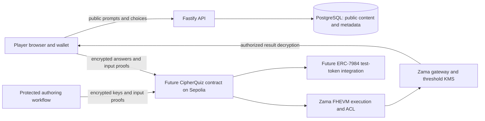
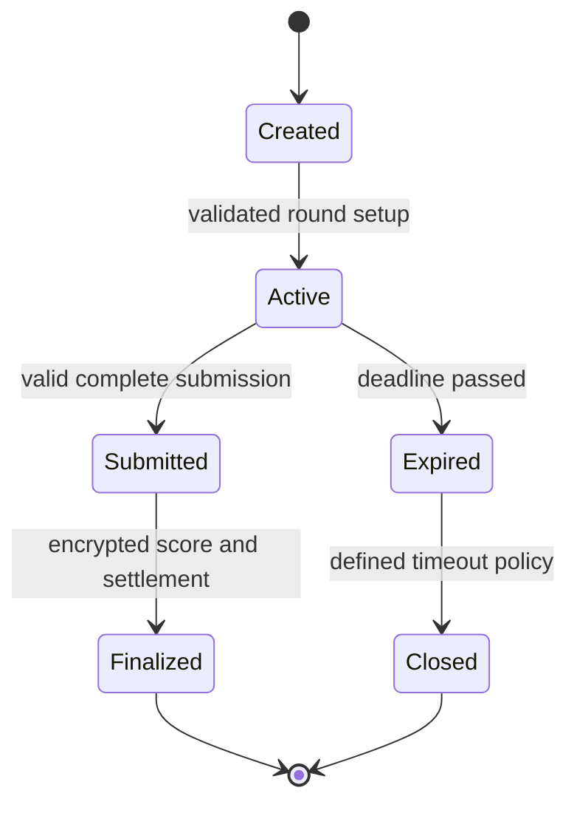

# Planned confidential architecture

Status: this document retains the longer-term design proposal. Phase 1 implements health checks and toolchain scaffolding. Phase 2 now implements a token-free local scoring subset; the [implemented architecture](encrypted-scoring.md) is authoritative for that contract, including its single-player rounds, batch deadline, encrypted context binding and final-score ACL. The settlement flows below remain unimplemented proposals.

## Components and data boundaries

This diagram is a design, not an implemented network. Wallet addresses, transaction timing, caller identities, round IDs and activity patterns remain observable. Hiding amounts does not hide participation. An operator who writes a question necessarily knows its answer; encrypted storage does not remove that trust.

The web app owns wallet interaction and eventual player-authorized decryption. The API serves public content and records non-secret metadata; it must not become a plaintext answer oracle or hold player decryption keys. PostgreSQL is not the authoritative source of score or settlement. The contract is intended to enforce round state and confidential computation. The blockchain package isolates chain configuration and future SDK adapters from rendering and public shared types.

## Proposed flow

1. **Curate and version content.** Prepare a prebuilt bank with stable question IDs, four choices and categories. Separate public prompts from protected answer indexes before creating exports or frontend bundles. Authoring infrastructure is out of scope. Bind the encrypted key set to immutable public question versions; unbound question edits could silently change what the player answered.
2. **Ingest encrypted answer keys.** The authorized content publisher encrypts answer indexes for the chosen contract and submitting identity using verified Zama input tooling. Validate proofs, publisher authorization, question IDs, choice bounds and immutable key versioning. The scoring contract needs persistent permission to its ciphertexts. Players and arbitrary operators must not receive key decryption rights. A plaintext hash of a four-option answer is brute-forceable; it is not an adequate secret commitment.
3. **Open a round.** Bind player, chain, contract, round nonce, content version and chosen question set. Record authoritative deadlines and allowed transitions. Exactly ten answers are expected. Staking is a later integration; currently no funds move.
4. **Submit answers before deadlines.** Encrypt player choices in the browser and submit with valid proofs. Enforce caller binding, replay prevention, one-answer policy, valid option indexes and deadline rules onchain. The browser timer is advisory. Malicious clients can submit arbitrary values unless encrypted range constraints are handled. Whether answers are per-question or batched remains undecided.
5. **Compute encrypted score.** Evaluate encrypted comparisons and accumulate an encrypted score using verified FHEVM primitives. Avoid branches, events or reverts that reveal whether an answer was correct. Ensure ACL permissions are retained on every newly created ciphertext and forwarded only where needed. No function signatures are specified before an implementation review.
6. **Compute and settle confidential rewards.** Proposed tiers are 10 → 2.0×, 8–9 → 1.5×, 7 → 1.2× and below 7 → 0×. These are total returns including principal. Use integer arithmetic with defined rounding and overflow bounds; do not use floating point. A future ERC-7984 integration must authorize only necessary ciphertext access and settle once. House reserves must cover maximum liabilities. Do not decrypt scores merely to choose a public payout branch.
7. **Authorize personal result reveal.** After finalization, only the designated player should be able to authorize decryption of the final score and their payout information. Bind authorization to the appropriate account, contracts, chain and validity window using the supported SDK flow. Never make answer keys or player scores publicly decryptable. Do not persist decryption keys or plaintext results in server logs, analytics or browser storage by default.

Zama's [ACL documentation](https://docs.zama.org/protocol/solidity-guides/smart-contract/acl) describes permissions for ciphertext computation and decryption. Permission tests must cover the complete lifecycle, including values derived from earlier ciphertexts. A wallet signature alone does not establish onchain ciphertext access.

## Proposed round state machine

No state machine is implemented. Cancellation, chain reorg handling, interrupted rounds and refunds need specification before funds are involved. Finalization and claims must be idempotent.

## Trust assumptions

- The browser, wallet and installed dependencies handle secrets correctly. A compromised page can read answers before encryption and results after decryption.
- Content publishers provide correct, consistent keys and do not leak or sell them. Publisher access and any admin upgrades must be disclosed and constrained.
- Ethereum supplies ordering and finality; deadlines based on block timestamps have limited precision and inclusion is affected by congestion.
- Zama FHEVM, input-proof verification, coprocessors, ACL and threshold KMS provide the documented confidentiality and availability properties. Local mock tests are not cryptographic security proofs.
- RPC, relayer and hosting services can observe metadata, delay traffic or become unavailable. Transport confidentiality does not eliminate those observations.
- Future token and reserve contracts behave as integrated, but insufficient balance and confidential token failure semantics require explicit handling.

## Outstanding security and product questions

| Question                                     | Required decision or evidence                                                                                                                                                      |
| -------------------------------------------- | ---------------------------------------------------------------------------------------------------------------------------------------------------------------------------------- |
| What does “timed” mean?                      | Choose duration, submission granularity, chain deadline, grace rules and fairness under Sepolia latency. Never trust client elapsed time.                                          |
| Can players infer keys from results?         | Full scores across repeated question sets can form an oracle. Bound attempts, rotate sets and analyze leakage before reusing a small bank.                                         |
| Can encryption prevent assistance?           | No. Search engines, LLMs, collusion, bots and multiple wallets remain possible. Specify a realistic threat model rather than promising cheat prevention.                           |
| How are questions selected fairly?           | Review randomness, predictable sets, publisher manipulation and replay; no randomness service is selected.                                                                         |
| How is bank integrity established?           | Define protected authoring, immutable version binding, authorized ingestion, key rotation and independent answer review.                                                           |
| What is the exact SDK compatibility surface? | Validate generic encrypted inputs and user decryption against SDK 3.7.2 and FHEVM Solidity 0.11.1; token-focused SDK examples alone are insufficient.                              |
| Which ERC-7984 implementation?               | Verify current standard, maintained library, supported FHEVM version, test-token address/code, operator permissions and transfer failure semantics. No token contract is selected. |
| How are funds protected?                     | Define maximum stake, reserve accounting, rounding, overflow, one-time settlement, reentrancy defenses and insolvency behavior.                                                    |
| Who can decrypt each value?                  | Maintain a per-handle ACL matrix with negative tests. Review any delegation, upgrades and administration for indirect key access.                                                  |
| What happens during outages?                 | Define expiry, recovery, finality and refund policy for RPC, relayer, KMS and chain failures.                                                                                      |
| What metadata leaks?                         | Measure event contents, transaction patterns, storage access and token-side observations; remove unnecessary disclosures.                                                          |
| How are secrets retained?                    | Define logging redaction, encrypted author backups and browser decryption lifecycle before adding sensitive content.                                                               |

## Next milestone acceptance criteria

Use dummy content and no tokens. Specify and test round identity, deadlines and replay handling. Prove local encrypted comparisons and score bounds with authorized and unauthorized actors. Verify the selected SDK's real generic-input and user-decryption APIs in an isolated experiment. Benchmark a ten-question circuit. Keep Sepolia deployment and token settlement separate and explicitly reviewed.
