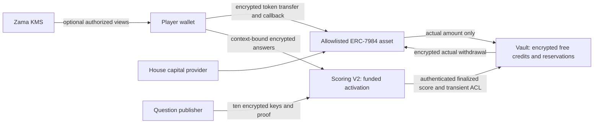

# Confidential staking and payout architecture

Reviewed **2026-11-14, Africa/Lagos**. Branch: **`feat/erc7984-staking-architecture`**, based on **`74b43e0`**. Status: **design plus isolated local proof of concept; no live staking deployment, RPC session, wallet signature, permit, token interaction or Sepolia spending in this phase**. This system is **not audited**. The three lab contracts reject constructor execution outside chain **31337**. Existing deployed scoring code, spending policy/reservations and approval flags are unchanged.

## Decision and evidence boundary

Use a single allowlisted ERC-7984 asset, an encrypted custodial ledger and segregated house liquidity. Reserve the player's principal plus enough house capital to cover the maximum **2x total return** before activating play. Settle by encrypted computation over an authenticated finalized score from a **new scoring deployment with a vault-only score-sharing interface**. No plaintext score oracle, player-supplied score or user-decryption permit is required to settle.

The [verified Sepolia round](sepolia-round-1-decryption.md) establishes real encrypted input acceptance, four-question score computation and authorized SDK/KMS decryption of **2/4**. It establishes neither ten-question paid-game performance nor token custody/payout safety. The deployed `CipherQuizScoring` at **0x4b4c204d28D5ee37896278C5fc56d61086f92b53** is immutable, has no staking gate or settlement callback and grants score rights to itself and the player. A public score handle is not permission for a vault to compute with it.

The frontend currently computes practice results from `QUESTIONS[].answer` in its public bundle, using number-based practice stakes 10/25/50. It is not a secure paid question bank or authoritative score source. The API has service scaffolding, not protected content delivery. `packages/blockchain/src/index.ts` still has Phase 1 placeholder deployment exports; actual reviewed addresses are in integration tooling/reports. Do not mark a staking deployment as live or wire wallet transfers to these placeholders. Existing practice behavior and tiers remain unchanged.

## Verified upstream APIs and dependencies

The [ERC-7984 specification](https://eips.ethereum.org/EIPS/eip-7984) remains **Draft** as reviewed. Its confidential pointers are represented by bytes32; resolution is implementation-specific. Its operator authorization is time-based and amount-unbounded, unlike ERC-20 allowances. Pin concrete implementation behavior rather than assuming every conforming token has identical failure semantics.

| Boundary                     | Exact version / evidence                                                             | Decision                                                                             |
| ---------------------------- | ------------------------------------------------------------------------------------ | ------------------------------------------------------------------------------------ |
| FHE Solidity / compiler      | `@fhevm/solidity 0.11.1`, Solidity **0.8.27**, Cancun, optimizer 800                 | Unchanged                                                                            |
| Confidential token contracts | **`@openzeppelin/confidential-contracts 0.5.3`**                                     | Installed exactly; current official npm release reviewed                             |
| OZ peers                     | **`@openzeppelin/contracts 5.6.1`**, **`@openzeppelin/contracts-upgradeable 5.6.1`** | Exact peers; the latter satisfies package metadata, not a decision to deploy proxies |
| Local FHE environment        | plugin/mock-utils **0.4.2**, legacy peer **0.4.1**                                   | Unchanged; local mock execution only                                                 |
| Application SDK              | **`@zama-fhe/sdk 3.7.2`**, underlying SDK **0.13.2**                                 | Unchanged; new compile-only token API checks, no live SDK instance                   |

Official [OZ v0.5.3 source](https://github.com/OpenZeppelin/openzeppelin-confidential-contracts/tree/v0.5.3) and npm peer metadata match the existing FHE library. This version includes the receiver-access fix described in the [OZ changelog](https://docs.openzeppelin.com/confidential-contracts/changelog). Imports compiled from `token/ERC7984/ERC7984.sol` and `interfaces/IERC7984Receiver.sol`; some older examples show a different path. Only these three packages were added to the lockfile; no FHE/SDK/toolchain upgrade was made. Lifecycle scripts and automatic audit were disabled during installation. This is compatibility verification, not an advisory audit or security certification. The [OZ overview](https://docs.openzeppelin.com/confidential-contracts) warns that the library has no compatibility guarantees or blanket security guarantees.

Verified signatures used by the lab (encrypted types encode as bytes32 on the wire):

```solidity
confidentialTransferAndCall(address to, externalEuint64 amount, bytes inputProof, bytes data)
  returns (euint64 transferred);
confidentialTransfer(address to, euint64 amount) returns (euint64 transferred);
setOperator(address operator, uint48 until);
onConfidentialTransferReceived(address operator, address from, euint64 actual, bytes data)
  returns (ebool accepted);
```

These are upstream interfaces, not new CipherQuiz promises. [OZ token API](https://docs.openzeppelin.com/confidential-contracts/api/token) and [receiver API](https://docs.openzeppelin.com/confidential-contracts/api/interfaces) were checked against installed source. An insufficient OZ sender balance produces an encrypted zero transfer; successful EVM receipt alone is not payment evidence. Returned actual amounts drive accounting. Receiver false/refund semantics are best-effort: never credit then return false, or manually refund and also return false. Our receiver accepts valid deposits with encrypted true, grants transient token access to that result and never moves assets out during the callback; public invalid mode/caller reverts the entire transfer.

The installed public SDK types expose `Token.confidentialTransferAndCall(to, amount, data, options?)`, `setOperator(operator, until?)`, `WrappedToken.shield(amount, {approvalStrategy:'exact'})` and `createWrappedToken`. These are checked in [staking-api-compatibility.ts](../packages/blockchain/src/staking-api-compatibility.ts). SDK convenience calls may decrypt balances, request permits or orchestrate multiple writes; type compatibility is not wire validation against a specific deployed wrapper. The opaque callback data must be encoded by the application. No SDK call is executed here. See [Token](https://docs.zama.org/protocol/sdk/api-references/sdk/token) and [WrappedToken](https://docs.zama.org/protocol/sdk/api-references/sdk/wrappedtoken).

## Sepolia token availability: candidates, not activated integrations

The following are **documentation-listed candidates** from Zama's [official Sepolia address directory](https://docs.zama.org/protocol/protocol-apps/addresses/testnet/sepolia), reviewed on the date above. No runtime code/registry/admin/decimal verification or faucet/wrap/approve transaction was performed. These are test assets, not fiat-backed funds or gameplay deposits already held by CipherQuiz.

| Role                       | Address                                      |
| -------------------------- | -------------------------------------------- |
| Wrappers registry          | `0x2f0750Bbb0A246059d80e94c454586a7F27a128e` |
| Candidate cUSDTMock        | `0x4E7B06D78965594eB5EF5414c357ca21E1554491` |
| Its mock underlying ERC-20 | `0xa7dA08FafDC9097Cc0E7D4f113A61e31d7e8e9b0` |
| Alternative cUSDCMock      | `0x7c5BF43B851c1dff1a4feE8dB225b87f2C223639` |
| Its mock underlying ERC-20 | `0x9b5Cd13b8eFbB58Dc25A05CF411D8056058aDFfF` |
| Alternative cWETHMock      | `0x46208622DA27d91db4f0393733C8BA082ed83158` |

The directory describes public minting of mock underlying tokens, capped at 1 million tokens per call; restricted non-mock assets are different. Do not substitute the protocol's ZAMA staking pools, plain USDT/ERC-20 or another chain's similarly named asset. Recommend evaluating **cUSDTMock** first for a token-free-value Sepolia exercise, contingent on the next read-only due-diligence gate.

Before selecting an asset: verify chain/code and any proxy implementation, registry validity and reciprocal underlying mapping, decimals/rate, initialized owner/pauser/observer configuration and the actual deployed transfer/callback behavior. Registry methods documented [here](https://docs.zama.org/protocol/protocol-apps/confidential-tokens/wrapper-registry) include `getConfidentialTokenAddress`, `getTokenAddress` and `isConfidentialTokenValid`; do not confuse them with differently named SDK registry adapters. Zero/nonzero address alone is insufficient. Pin an allowlist entry with reviewed implementation/admin policy, not merely ERC-165 support. A registry revocation or token upgrade must stop new exposure and trigger review; it does not itself recover user assets.

Official [wrapper source linked by Zama](https://github.com/zama-ai/protocol-apps/blob/02333309049d87627f1e032c179a8a497998d346/contracts/confidential-wrapper/contracts/ConfidentialWrapper.sol) is upgradeable and has pause, denylist and wildcard observer administration. It is not identical to our minimal non-upgradeable OZ fixture. An observer may see wrapper-owned amounts even when CipherQuiz's ACL denies its operator. A token issuer/admin can therefore weaken confidentiality or availability. Review the deployed version/configuration before use; no deployment-state claim is inferred from this repository snapshot.

## Components and immutable identities



One vault accepts exactly one asset. Ticket identity includes chain ID, immutable scorer/vault/asset identities, ticket nonce and scorer round ID; database/client round IDs alone cannot identify a payable claim across deployments. Payout policy, units and question-count rules are frozen per version. A round snapshots public content/version commitment and timing policy before activation. Public IDs, actors, timing, token choice, phase and transaction patterns remain visible; amounts and admission/payout values remain encrypted.

Use a factory that atomically deploys an unconfigured non-upgradeable vault, deploys Scoring V2 with that vault address, then binds the scorer **exactly once** before enabling deposits/tickets. Verify the scorer's vault/operator/protocol identity and code during binding. A naive mutually immutable CREATE2 construction has circular initcode/address dependencies; do not assume it solves itself. The lab uses a simpler one-time local configurer and does **not** implement the production factory's attestation/activation controls. No admin may later swap asset/scorer or sweep liabilities.

## Exact ten-question economic rules

Multipliers are **total returns including principal**, matching `apps/web/src/game/model.ts`, not profit paid on top:

| Final score | Total return | On a 25-token stake |
| ----------- | -----------: | ------------------: |
| 10/10       |         2.0x |                  50 |
| 8–9/10      |         1.5x |                37.5 |
| 7/10        |         1.2x |                  30 |
| 0–6/10      |           0x |                   0 |

Paid rounds require **exactly ten** source questions; reject four-question rounds at admission and settlement. Do not scale 2/4 to a ten-question score or attach funds retroactively to Sepolia round 1. The V1 scorer supports 1–10 questions, while the frontend assumes ten; new funded entrypoints must enforce ten rather than relying on the UI. Scores outside 0–10 map to no payout as defense in depth, never the frontend helper's broader `>=8` condition without an upper bound.

MVP menu: encrypted stake equal to 10, 25 or 50 token units; the selected menu entry need not be public. The local fixture uses six decimals, `UNIT = 10^6`, and masks invalid stakes to zero **before arithmetic**. All valid base-unit amounts are divisible by 10. Compute `tenth = stake / 10`, then encrypted score selects `20*tenth`, `15*tenth`, `12*tenth` or zero. This exactly preserves fractional-token returns and avoids multiplying an unchecked arbitrary uint64 by 20. Do not use JavaScript floating point for real amounts. Future arbitrary stakes require explicit floor rounding and either safe public bounds (`stake <= floor(MAX_UINT64/20)`) or separately benchmarked wider intermediate arithmetic; the divide-first formula is not correct for arbitrary nonmultiples of 10.

## Encrypted ledger and solvency proof

Let `A` be actual token assets held by the vault, `U_i` each user's withdrawable credit, `H` unreserved house capital, and `(L_j,R_j)` each unsettled ticket's principal and profit reserve. Maintain:

```text
A >= sum(U_i) + H + sum(L_j + R_j)
0 <= payout_j <= L_j + R_j
```

Equality holds for accounted vanilla-token flows. Bare transfers without the callback are unassigned surplus, not credits or automatically withdrawable house profit. Never reconstruct deposits from user-supplied requested amounts or ambiguous balance deltas. All rights arise from authenticated token callbacks or existing ledger state.

Admission computes encrypted `b = menuValid(s) AND U_player>=s AND H>=s`. Select `a = b ? s : 0` and atomically update `U-=a`, `H-=a`, `L=a`, `R=a`. The bankroll reserves **one additional stake**, not two additional stakes, because the player's principal is already in custody. Maximum claim is `L+R=2a`. Hiding `b` avoids a public solvency predicate; each request still creates a public ticket, whose encrypted admission receipt is readable only by the player. Failed admission reserves/debits zero and cannot pay anything. The player must inspect that private result before treating the round as funded. Consume the ticket once rather than allowing publicly observable conditional retries on encrypted failure.

Settlement performs effects before external interaction, derives payout `q` only from the ticket's authenticated finalized score, then atomically closes the ticket, credits `U_player += q`, returns `H += L+R-q`, and removes both liabilities. Keep historical handles if useful, but closed tickets are excluded from liability sums. Settlement is permissionless but always credits the recorded player, never the caller. No external token transfer occurs in settlement; payouts become private withdrawable credits. Pending and active reservations both count until closed.

Solvency is not profitability: repeated perfect scores consume one house stake per round until new admissions become encrypted zero. Leaked answers, publisher collusion and bots can exhaust that finite bankroll without violating the invariant. Require independent content review, a bounded house risk budget and explicit acceptance of those economics. Pending reservations also permit capital-griefing attempts: enforce short immutable activation windows, bounded ticket/concurrency policies and analyze Sybil abuse; a per-address cap alone does not solve it.

Withdrawals select at most the caller's free credit, debit it before calling the allowlisted token, pass transient amount access to the token, and subtract **only the actual amount transferred** from total liability. Restore `requestedSelected-actual` to credit on encrypted zero/short transfer. A revert rolls back the debit. Locked principal/reserves cannot be withdrawn. House exits follow the same actual-transfer reconciliation using **only H**, to the fixed capital owner; no LP shares, borrowing, fractional reserve or multi-asset valuation are included in MVP. All mutating entrypoints, including the receiver, use a reentrancy guard.

For a trusted fixed-supply, non-rebasing uint64 token with actual-transfer semantics, each nonnegative ledger component is bounded by assets. Masked menu stakes cap intermediate payout products; a public ticket-closed guard prevents duplicate accounting. Token callback trust, upgrade risk and proof of invariants remain security obligations: a lying/malicious/rebasing token cannot be made safe merely by inspecting its reported encrypted return. Reject fee-on-transfer, rebasing and unreviewed hook variants. The invariant covers token-unit liabilities, not underlying-wrapper backing, issuer seizure, depeg or redeemability. Mock tokens have no promised financial value. No unbounded loops over all accounts/tickets may appear in transaction paths.

Production should also provide a new application `withdrawAll()` path that uses the caller's stored encrypted free-credit handle, grants the token transient access and reconciles the actual return exactly as above. It needs neither a plaintext balance nor a fresh input proof, avoiding an unnecessary KMS-view dependency for exits. This path is proposed, not implemented in the reduced lab. It still depends on the token/FHE host infrastructure accepting transfers; it cannot defeat issuer freezes.

## Proposed production lifecycle and timeout policy

The following names are **proposed CipherQuiz interfaces**, not undocumented Zama/OZ APIs. Only the score-sharing subset is implemented in the lab.

1. **Pending ticket:** player requests a ticket using a stake proof bound to vault/player. Freeze asset, policy version, ten-question content commitment, activation expiry and play duration. Reserve the encrypted principal/profit together. No active game exists yet.
2. **Activation:** the answer publisher calls Scoring V2 directly with ten encrypted keys/proof, preserving the proof's scoring-contract/operator binding. Scoring atomically calls vault `activateTicket(ticketId, roundId)`; the vault authenticates the scorer, player/content/policy binding, pending phase and expiry. Failure reverts round creation. Store a unique reciprocal ticket/round mapping. Set the submission deadline from the accepted play-duration policy, not an arbitrary near-zero operator deadline. Never proxy ordinary player `submitAnswers` through the vault: V1 proof/caller binding would change.
3. **Submission:** player submits exactly ten context-packed answers directly to Scoring V2. Preserve V1's sender/contract proof checks, consumed-input registry and 48-bit round / question-index context. Scoring must also require an activated ticket. Obtain its encrypted admission bit through a scorer-only vault method with transient ACL and mask the score to zero for failed admission, so zero-funded tickets are not an unlimited useful answer-key oracle. The lab does not yet implement this production gate/masking.
4. **Finalization and settlement:** any keeper may call vault settlement. Vault can call a V2 vault-authorized finalization path for Submitted or expired Open rounds, so the publisher cannot hold completed payouts hostage. V2 retains the original score, verifies ten-question metadata, and exposes `shareFinalizedScore(roundId)` only to its fixed vault with `FHE.allowTransient`. The vault checks source, player, phase and question count and consumes that exact handle. No caller-selected source, score handle or plaintext/re-encrypted score is accepted.
5. **Refund before activation:** player may cancel a pending unactivated ticket, or anyone may close it once the publisher misses activation expiry. Restore `L` to the player's free credit and `R` to H exactly once. Activation and refund are mutually exclusive state transitions in one chain order. No fee or payout depending on a hidden score is involved.
6. **Active timeout:** no submission by the exclusive deadline is a **forfeit (0x)**, not a principal refund. A Submitted round remains settleable after its deadline. Refunding active abandoned or already-scored losing rounds creates a free option, allowing players to avoid losses. The product must disclose this policy before staking. Never accept a client-reported RPC/KMS error as refund evidence. KMS view availability is not a settlement prerequisite. Broader protocol outages need a separately approved, score-independent incident/insurance policy; do not ship discretionary per-user post-result refunds or silently claim guaranteed recovery during a global freeze. New admissions can pause while existing settlement/refunds/withdrawals remain available whenever the underlying protocol/token permits them.

No design can make a frozen external asset transferable. Active-round outage fairness, maximum reserve duration and content-delivery service levels require product/security approval before any real-value deployment. They are explicit release gates, not solved by this prototype.

## ACL and disclosure matrix

| Handle                                        | Persistent contract access           | EOA access                                                          | External handoff                                                                  |
| --------------------------------------------- | ------------------------------------ | ------------------------------------------------------------------- | --------------------------------------------------------------------------------- |
| Answer keys                                   | Scorer only                          | No player/house/operator decryption grant                           | None                                                                              |
| Final score                                   | Scorer; player after finalization    | Player only                                                         | Vault transiently during settlement                                               |
| Free user balance / admission / ticket payout | Vault                                | Owner only                                                          | None unless explicitly requested                                                  |
| Locked stake / reserve                        | Vault                                | Player for own stake/admission; avoid adding observers              | Token only if needed for an actual transfer                                       |
| House free balance                            | Vault                                | Lab grants HOUSE; production policy must acknowledge inference risk | None                                                                              |
| Token balances / transfers                    | Token plus holders under token rules | Relevant holders; token observers may have broader rights           | Actual transfer to receiver; requested vault withdrawal amount transient to token |

Persist every newly stored ciphertext with `FHE.allowThis`; grant only the intended owner explicitly. Getter visibility and public handles are not ACL permission. Do not call `makePubliclyDecryptable` for vault balances, admissions, payouts or scores. The token receiver must grant transient token permission for its encrypted success result; withdrawal must grant token access to the selected amount. [FHE ACL documentation](https://docs.zama.org/protocol/solidity-guides/smart-contract/acl) and [encrypted operations](https://docs.zama.org/protocol/solidity-guides/smart-contract/operations) were checked against installed library signatures.

House visibility is a real side channel: decrypting H before and after one isolated settlement can reveal the payout tier, even without direct score ACL. The baseline single-house model follows the lab's HOUSE viewer policy and therefore requires explicit acceptance of that treasury inference risk. A stronger privacy version must restrict treasury visibility/exit timing through batched epochs and separately analyze withdrawal probing; it is additional design work, not a property of this MVP. Merely denying score ACL does not eliminate this inference. Wrapper wildcard observers, metadata, public funding/unwrap amounts, repeated content and player score queries add further leakage. Publisher knowledge of answer keys, collusion, bots/LLMs and repeated-question inference are not prevented by FHE.

## Existing scorer compatibility and migration

V1's finalized getter exposes a handle but does not grant a consumer permission. A player might opt into an explicit lower-level ACL grant after finalization, but an EIP-712 decryption permit alone is not that onchain computation grant. A post-result, player-dependent sharing flow is unsuitable as the production settlement dependency: the player can withhold it, and refunds on withholding create a free option. No existing round gets retroactive financial rights.

The local `ScoringForVaultLab` is a **new derived deployment**, grants the fixed vault transient access and proves the interface can work. It does not upgrade or mutate deployed V1, nor implement funded activation/keeper finalization. Production requires a new reviewed Scoring V2 file/deployment with the additional gates and vault-only score handoff; keep V1 source/creation hash frozen. Existing round 1 stays token-free historical evidence. Already issued handles/permits belong to their existing contracts and are not magically migrated. Frontend/API descriptors must distinguish `(chain, scorer version/address, vault, asset, roundId)` and keep historical reads separate; do not overwrite V1 address or reuse its old deployment approvals.

## Local proof of concept and performance boundary

See [local validation](confidential-staking-local-validation.md). `ConfidentialTokenLab` uses the actual pinned OZ implementation with explicitly unsafe test-only mint/failure controls; `ScoringForVaultLab` extends unchanged scoring logic; `ConfidentialStakeVaultLab` exercises actual callback credit, encrypted admission/reservation, one-time tier settlement and actual-transfer withdrawal reconciliation. All constructors reject non-31337 chains, tests require Hardhat/mock mode, and no live runner or deployment command was added. Missing factory/activation/refund/treasury-exit/incident controls mean these contracts must not be promoted to production.

Local mock settlement for 10/10 measured **450007 gas**, **3071032 global HCU**, **1569000 depth HCU**. The earlier ten-answer scoring mock measured **4840352 global HCU** and **1158032 depth**. These are separate transactions and software cost tables, not live fee or latency estimates. The [current HCU guide](https://docs.zama.org/protocol/solidity-guides/development-guide/hcu) labels its published **20M global / 5M depth** limits as **devnet**; they are not asserted as verified current Sepolia configuration. Before any live staking approval, read target protocol limits, estimate every actual deployed call and allocate shared ledger headroom under the existing fee/cap policy. Keep deposit, reservation, ten-answer submission, settlement and withdrawal separate until measured. Avoid unbounded batching and expensive wide/encrypted multiplication; local HCU profiling must use the plugin's actual receipt API.

## Frontend, wrapper boundary and staged implementation

Keep the practice UI unchanged until a reviewed funded backend exists. Real amounts use `bigint` plus verified token decimals, never `number` or a hardcoded assumed underlying scale. Separate public prompts from private authoring keys; remove `answer` values from paid-game bundles/API responses. Bind content versions and source identities; round timers derive from chain deadlines. Display a private admitted/zero-stake result and actual transfer outcome rather than treating mined receipt as funded success. Index public phases only; never store wallet keys, permits, transport keys, plaintext answers or decrypted balances on the API. Use per-wallet in-memory credentials by default and disclose supported permit lifetimes/scopes explicitly. Do not let convenience SDK auto-sign/regrant/retry paths bypass future approvals or error handling.

Prefer a player-initiated ERC-7984 push callback to grant-free vault deposits. If a pull flow is later introduced, `setOperator(vault, until)` authorizes full balance spending until expiry; use short expiry/revocation and a narrowly reviewed vault, not an invented per-amount ERC-20 allowance. Underlying ERC-20 wrapping is a separate flow, with exact public allowance or ERC-1363 transfer-and-call. The [official wrapper guide](https://docs.zama.org/protocol/protocol-apps/confidential-tokens/confidential-wrapper) explains public decimal conversion and asynchronous unwrap. Confidential vault withdrawal should return ERC-7984 to the player's wallet, leaving optional unwrap outside core settlement. Unwrap can publicly reveal its actual amount and needs a proof/finalization transaction; high-level `shield`/`unshield` can initiate multiple writes. Inventory each write/signature before any future execution approval; none is authorized here.

1. **Now, local-only:** retain architecture, verified dependency pins, source compatibility checks and explicit lab tests; complete `npm run check`. No live addresses become application configuration.
2. **Next, still local:** implement an independent production candidate with factory/write-once binding, pending/active/refund state machine, atomic activation, encrypted admission masking, keeper settlement, house exits and pause boundaries. Add adversarial hooks/reentrancy tests, proof/replay/decimal/rounding/uint64 boundaries, concurrent ticket/claim/withdraw sequences, randomized conservation invariants and incident/forfeit races. Require an independent security review; this prototype is not that review.
3. **Read-only network gate:** with appropriate next-phase scope, verify target token registry/code/proxy/admins/observers/decimals/rate and network HCU limits; audit ABI/SDK compatibility against the exact deployed version. Prepare individual gas estimates and a concrete transaction/signature inventory; retain all existing reservations and **0.02 ETH** aggregate cap. No automatic flag activation or token faucet/wrap call.
4. **Separately approved testnet experiment:** only after the local/state-machine/token gates pass, request explicit approval for precisely named new deployments, funding/approval/token writes, ten-question flow and scoped permits. Do not reuse scoring-only approvals. Demonstrate real actual-transfer failures and 10-question FHE payouts, reconcile receipts and permanent reservations, then stop.
5. **Before real value:** settle publisher/content trust, outage/refund fairness, token observer/privacy policy, treasury probing/exit policy, independent review, monitoring and incident response. Reassess draft-standard/version changes and any token upgrades. No merge, production release or audit claim follows from these local results.

**Stop after design and local validation. No live staking deployment or transaction is approved.**
