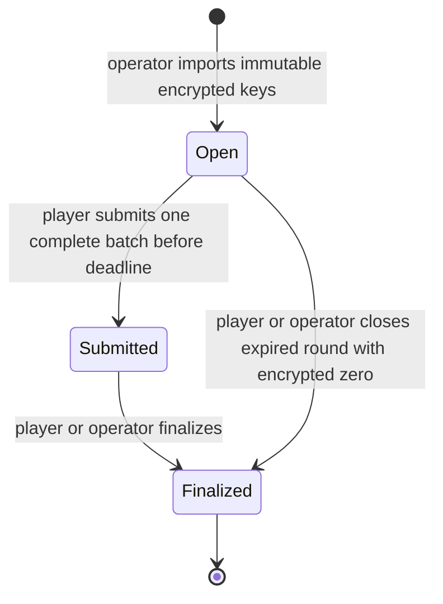

# Phase 2: local encrypted scoring

Implemented on 2026-11-11 with dummy data and no tokens. This is a local FHEVM proof of concept, not a deployed service or cryptographic security audit. The Phase 1 browser, Fastify API, PostgreSQL readiness boundary and disclaimer remain unchanged.

## Contract architecture

`contracts/src/CipherQuizScoring.sol` inherits the existing foundation's `ZamaEthereumConfig`. Deployment fixes one nonzero `OPERATOR`; there is no upgrade, operator replacement, payment, token or settlement path.

Each round has one designated player, a monotonically assigned ID, an exclusive block timestamp deadline, a nonzero public content hash, one to ten encrypted answer keys and an encrypted `euint8` score. A multiplayer game would create a separate round per player. The operator atomically imports all encrypted keys using `FHE.fromExternal` and opens the round. No setter can change keys, player, content or deadline afterwards. The content hash must cover the ordered public questions, choices and versions; the operator is responsible for supplying the corresponding correct keys. The contract cannot verify offchain question semantics.



Only the designated player submits; only that player or the operator finalizes. Submitted rounds can finalize immediately or after expiry without losing their computed score. Open rounds cannot finalize before expiry. Repeated submission and finalization revert. Expiry means `block.timestamp >= deadline`; no browser or API time is trusted. There is one round deadline, not a per-question timer.

## Input format, binding and replay protection

Keys are external encrypted `uint64` choices. Valid keys are 0 through 3. Player inputs use the same encrypted type, with the following plaintext bit layout **before encryption**:

```text
bits 63..16: round ID (48 bits, starting at 1)
bits 15..8:  zero-based question index (0..9)
bits 7..0:   choice (0..3)
value = (roundId << 16) | (questionIndex << 8) | choice
```

Client code must validate these field bounds before packing; use BigInt in JavaScript. Never place a real key in public content or logs. Round allocation stops at the 48-bit context limit, so contexts cannot wrap. The caller reads the actual allocated round ID after creation; predicting `nextRoundId` is unnecessary for key encryption.

Each external handle is imported with the supplied input proof. The official verifier binds inputs to the submitting address and contract; application round and question binding comes from comparing the **entire encrypted packed answer** against the expected context plus the encrypted key. A wrong context is accepted as a submission but contributes zero; it does not produce a plaintext validity signal or revert. This distinction is intentional and tested. Contract and sender mismatches, malformed proofs, and handles absent from a proof revert.

`usedInputs` consumes key and answer handles globally across this contract. Reuse across rounds or within a batch reverts, and a failed transaction rolls back consumption. Fresh encryption can produce new handles for the same plaintext; the single-submission round state and context comparison remain necessary. This is not a global ban on repeating answers across newly authorized rounds. No relayed signatures or meta-transactions are supported.

## Encrypted computation and confidentiality

For each question the circuit computes:

```text
validKey = FHE.lt(key, 4)
expected = FHE.add(key, publicRoundAndQuestionContext)
correct = FHE.and(validKey, FHE.eq(answer, expected))
score = FHE.add(score, FHE.asEuint8(correct))
```

No plaintext answer arithmetic implements scoring. Only public context construction is ordinary Solidity arithmetic. Invalid encrypted keys and invalid choice bytes contribute zero without secret-dependent events or reverts. The key validity mask also prevents an overflowing malicious key from earning credit. At most ten encrypted booleans are added, so the score is bounded by ten without `euint8` overflow.

**The operator knows every answer it authors and encrypts.** Keys are encrypted in contract inputs and storage; they are not protected from that operator, its browser or its authoring system. Local tests necessarily contain public dummy keys. There are no real question-bank secrets or protected authoring facilities in this repository.

| Value                               | Persistent permission explicitly granted by this contract | User-visible behavior                                             |
| ----------------------------------- | --------------------------------------------------------- | ----------------------------------------------------------------- |
| Imported key                        | Contract via `FHE.allowThis`                              | Public handle, no player grant                                    |
| Submitted answer                    | None; used transiently for scoring                        | Public transaction handle; submitter already knows the answer     |
| Intermediate circuit values         | None; transaction-local only                              | No application getter or plaintext reveal                         |
| Submitted score                     | Contract via `FHE.allowThis`                              | Public handle, no user grant before finalization                  |
| Final score, including expired zero | Contract and designated player via `FHE.allow`            | Player can request user decryption; no operator or stranger grant |

Persistent contract permission lets keys survive the opening transaction and the score survive until finalization. Every stored ciphertext is covered. No call uses `makePubliclyDecryptable`, delegation or arbitrary permission forwarding. Returning a handle does not authorize decryption. Grants are permanent; finalization is irreversible. An authorized player can share a decrypted score or grant protocol-level delegation outside this contract. Existing proof-layer permissions are not revoked by the application.

## Local workflow and evidence

Use the existing lockfile and supported Node/npm versions:

```sh
npm ci
npm test -w @cipherquiz/contracts
npm run check
```

The suite fails if it is not running in the local FHEVM mock environment; it does not silently skip network tests. It uses the official plugin's `createEncryptedInput(...).add64(...).encrypt()`, `userDecryptEuint`, `publicDecryptEuint`, and deployed ACL `persistAllowed` queries. Negative decrypt tests require an authorization-related error, not just any exception. No debugger plaintext decryption bypass is used.

The official mock executes the FHE contract operations with simulated cryptography. Passing tests establish local contract and mock ACL behavior, not real ZK proof generation, threshold KMS denial or end-to-end cryptographic confidentiality. No negative local ACL test is skipped; the equivalent live network tests remain outstanding.

The ten-question circuit was exercised with a score of ten. See the verification record for mock gas and HCU measurements. They do not measure encryption latency, coprocessor wall time, real network cost or production throughput.

## SDK compatibility boundary

The installed plugin 0.4.2 requires the exact legacy `@zama-fhe/relayer-sdk` 0.4.1 peer and works locally with Solidity 0.11.1, mock-utils 0.4.2, Hardhat 2.28.6 and ethers 6.17.0. These workflows were executed, not inferred from compilation.

The application SDK 3.7.2 uses `@fhevm/sdk` 0.13.2 internally, not the legacy relayer package. Inspection of its installed exports and declarations confirms generic `sdk.encrypt({ values: [{ type: 'euint64', value }], contractAddress, userAddress })`, returning `encryptedValues` and `inputProof`, and `sdk.decryption.decryptValues([{ encryptedValue, contractAddress }])`. `packages/blockchain/src/sdk-compatibility.ts` checks those public input/output shapes and both adapter configurations during normal build/typecheck; it initializes nothing and is not an integration adapter.

Installed ethers 6.17.0 and Viem 2.57.17 satisfy SDK peer ranges (`>=6` and `>=2` respectively); Wagmi 3.7.11 uses that Viem installation. The browser remains on its existing Wagmi provider. No Zama React provider is installed or needed for this contract-only milestone.

**API availability and peer compatibility are verified; application SDK-to-contract wire compatibility is not.** Neither the newer SDK nor its cleartext backend is substituted for the plugin in these tests. The newer SDK discovers protocol and module versions from chain state; this local proof does not establish that it can drive the older mock host configuration. No evidence currently requires a dependency upgrade or downgrade for the local contract work.

Smallest safe integration step: retain the exact lockfile and workspace split, then run an isolated current-SDK encryption → submission → authorized user-decryption experiment against a supported FHEVM network with dummy data, including a real unauthorized decrypt request. If protocol incompatibility appears, propose a coordinated Solidity/plugin/mock/SDK upgrade using the official template and peer constraints before changing dependencies. Do not replace only the plugin's legacy peer, use undocumented methods, or claim a cleartext backend proves FHE compatibility.

Official sources reviewed alongside installed source on 2026-11-11:

- [Hardhat template manifest](https://github.com/zama-ai/fhevm-hardhat-template/blob/main/package.json) and [counter tests](https://github.com/zama-ai/fhevm-hardhat-template/blob/main/test/FHECounter.ts).
- [Encrypted inputs](https://docs.zama.org/protocol/solidity-guides/smart-contract/inputs), [FHE operations](https://docs.zama.org/protocol/solidity-guides/smart-contract/operations), [ACL](https://docs.zama.org/protocol/solidity-guides/smart-contract/acl), and [Hardhat testing](https://docs.zama.org/protocol/solidity-guides/development-guide/hardhat/write_test).
- [Current SDK overview](https://docs.zama.org/protocol/sdk), [generic SDK reference](https://docs.zama.org/protocol/sdk/api-references/sdk/zamasdk), and [legacy relayer repository](https://github.com/zama-ai/relayer-sdk).

## Security assumptions and work before testnet

- Block timestamps and inclusion order have limited precision and can be influenced by validators, congestion, reorgs and censorship. No fairness guarantee follows from a deadline. The round offers no cancellation or recovery beyond expiry finalization.
- The operator can supply wrong keys, mismatched content, short deadlines, repeated question sets or selective access. Encrypted storage cannot validate truth, prevent operator collusion, or hide author knowledge. A nonzero content hash commits bytes supplied by the operator, not independent correctness.
- Prompts and choices are public. Question reuse, external assistance, bots, multiple wallets and score inference across rounds remain possible. The operator authorizes new attempts; no identity or question-selection policy is implemented.
- Addresses, round IDs, content hashes, deadlines, lengths, transaction timing, ciphertext handles and state transitions are public. No event reveals correctness, but metadata is not concealed.
- Trust the wallet/browser, FHEVM library, input verifier, ACL, coprocessors, relayer and threshold KMS. A compromised client sees answers before encryption and results after decryption. Local mock state is inspectable and must never receive real secrets.
- Final score access is deliberately granted only at finalization. Operator/player availability is needed to finalize; unauthorized third parties cannot close a round. A player contract must be capable of calling the relevant methods.
- Before testnet: verify current-SDK wire compatibility and real proof/ACL denial, benchmark latency and network HCU limits, review this contract independently, specify content canonicalization and authoring, test boundary round IDs, decide timing/finality policies and UI secret handling. Add browser/API integration only after that experiment. Deployment and any financial features remain separate work.

Dependency manifests, lockfile, workspace boundaries and existing scripts are unchanged.
