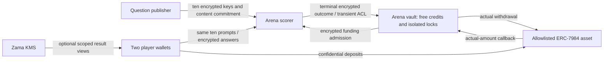
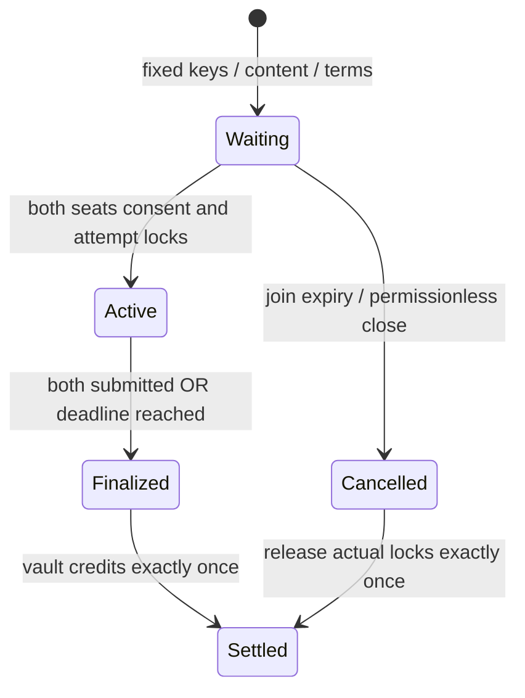

# Hidden Score Arena: Phase A architecture

Reviewed **2026-11-14 (Africa/Lagos)**. Branch **`feat/hidden-score-arena`**, based on verified staking head **`5fe1c5c81bb69f444237c1a975932902946829bc`**. This specifies the proposed funded game and distinguishes it from the [local proof of concept](hidden-score-arena-local-validation.md). It is not an audit, production readiness claim or deployment authorization.

## Scope and migration

Two distinct players receive the same ordered **ten** questions. One immutable encrypted answer-key array determines two encrypted scores; FHE compares them and computes confidential entitlement. The backend distributes content and indexes state; it cannot declare a winner to the contract.

Preserve single-player **Stake & Win**: 10/10 returns 2.0x, 8-9/10 returns 1.5x, 7/10 returns 1.2x and 0-6/10 returns zero, including principal. Arena proposes a separate **zero-fee, equal-stake pot**: winner receives 2S, loser zero, ties refund S each. These are distinct policies, not a replacement for the single-player tiers. Any future fee needs a new immutable policy and rounding review.

The non-upgradeable Sepolia `CipherQuizScoring` at **0x4b4c204d28D5ee37896278C5fc56d61086f92b53** stores one player per round and has no score-sharing method. Reading a public handle does not grant a new consumer computation ACL. A player re-encrypting a score does not prove provenance. Two V1 rounds also lack an atomic common key/content/funding commitment. **Arena requires a separate scorer and settlement component.** No change to deployed V1, retroactive staking or reuse of V1 round 1 as a payable Arena claim is proposed.

The real single-player Sepolia/KMS result **2/4** validates that four-question path only. Arena requires ten; do not extrapolate it to multiplayer or funded rounds. Preserve the frontend design, practice mode, existing staking implementation/design and gated live runners. No new frontend mode or complete funded game is implemented in Phase A.

## Verified dependencies and APIs

No dependency/lockfile change is needed. Existing exact versions: Solidity **0.8.27**, FHEVM Solidity **0.11.1**, encrypted-types **0.0.4**, Hardhat **2.28.6**, official Hardhat plugin/mock-utils **0.4.2**, relayer SDK **0.4.1**, public Zama SDK **3.7.2**, OZ Confidential Contracts **0.5.3**, OZ Contracts and upgradeable peer **5.6.1**. This is repository compatibility evidence, not a claim these are the latest releases.

| Official reference checked                                                                                                                                                                                                                                                           | Verified boundary                                                                                                                                                                                                                |
| ------------------------------------------------------------------------------------------------------------------------------------------------------------------------------------------------------------------------------------------------------------------------------------ | -------------------------------------------------------------------------------------------------------------------------------------------------------------------------------------------------------------------------------- |
| [Zama operations](https://docs.zama.org/protocol/solidity-guides/smart-contract/operations) and [encrypted branching](https://docs.zama.org/protocol/solidity-guides/smart-contract/logics/conditions)                                                                               | `eq`, `gt`, `lt`, `and`, `add`, casts and `select` compile against installed 0.11.1 and execute locally. Secret comparisons return `ebool`; Solidity `if` cannot branch on it.                                                   |
| [Zama ACL](https://docs.zama.org/protocol/solidity-guides/smart-contract/acl)                                                                                                                                                                                                        | `allowThis` persists computation access, `allow` grants participant access and `allowTransient` provides same-transaction consumer access. No public score grant.                                                                |
| [Official Hardhat template](https://github.com/zama-ai/fhevm-hardhat-template/blob/main/package.json)                                                                                                                                                                                | Confirms the toolchain family; exact overloads are verified by compiling installed sources, not copying a moving upstream branch.                                                                                                |
| [Generic SDK encryption/decryption](https://docs.zama.org/protocol/sdk/guides/encrypt-decrypt)                                                                                                                                                                                       | Existing `sdk.encrypt({values, contractAddress, userAddress})` and `sdk.decryption.decryptValues(...)` surface matches existing compile-only assertions and single-player integration. No new live SDK/permit/relayer call here. |
| [ERC-7984 draft](https://eips.ethereum.org/EIPS/eip-7984), [OZ token guide](https://docs.openzeppelin.com/confidential-contracts/token), [tagged 0.5.3 interface](https://github.com/OpenZeppelin/openzeppelin-confidential-contracts/blob/v0.5.3/contracts/interfaces/IERC7984.sol) | Credit actual transferred amounts through authenticated callbacks. Timed `setOperator` is broad account authority, not an ERC-20 amount allowance. Prefer direct transfer-and-call deposits.                                     |
| [OZ security caveats](https://docs.openzeppelin.com/confidential-contracts)                                                                                                                                                                                                          | No blanket audit/backward-compatibility guarantee. Pin and review the token implementation and administration.                                                                                                                   |
| [Encrypted randomness](https://docs.zama.org/protocol/solidity-guides/smart-contract/operations/random)                                                                                                                                                                              | Supported, but a private random integer alone does not select public questions fairly. No randomness implementation in this lab.                                                                                                 |
| [HCU guide](https://docs.zama.org/protocol/solidity-guides/development-guide/hcu)                                                                                                                                                                                                    | EVM gas, total HCU and sequential depth are separate constraints. Example devnet limits are not a target-network guarantee.                                                                                                      |

Tests use the official plugin's `createEncryptedInput(...).add64(...).encrypt()` and local user-decryption helpers. These are **mock plugin APIs**, not the public SDK or real KMS. Existing generic SDK and token compatibility modules remain unchanged and are typechecked by the full check. No speculative API is added.

## Components and immutable commitments



Production must bind chain, scorer, vault, token and policy versions immutably. Use an atomic factory with one-time source binding **before** deposits; attest both reverse bindings and expected code. Mutually dependent CREATE2 initcodes do not automatically solve circular construction. The local consumer's trusted one-time configurer is not production factory attestation.

Factory wiring and encrypted input import are separate operations. `FHE.fromExternal` validates the current caller: a factory forwarding a publisher's EOA-bound proof changes `msg.sender` and must not be assumed compatible. The publisher directly commits the stake quote/proof to the vault, then directly commits keys/proof to the scorer. Each proof targets its importing contract and actual caller. The write-once vault quote binds reserved players, round nonce, manifest and policy; the scorer verifies that fixed quote identity before opening Waiting. No stake locks until both commitments exist and agree. Do not forward input proofs through an unverified factory/router.

Before either stake locks, creation fixes both reserved seats, exactly ten ordered question versions and encrypted key handles, content/bank commitments, common encrypted stake S, asset, payout/refund policy, join expiry and answer duration. No key setter, player replacement or deadline extension is permitted after creation. FHE input proofs bind key import to scorer/publisher, not to semantic correctness.

Define a versioned canonical manifest using ABI encoding of ordered `(questionId, revision, promptHash, four ordered choice hashes)`. Domain-separate its commitment with chain, scorer, players, round nonce, timing, asset, policy and encrypted-key-handle digest. Both clients must verify the same available manifest and frozen terms before staking. Fix text normalization and encoding; do not depend on JSON property order. Persist creation commitments/handle digest; no later replacement.

The lab stores a nonzero content hash and immutable key handles but **does not enforce canonical manifests, bank membership, plaintext-key correspondence or content availability**. A hash commits to bytes, not correct real-world answers. A separate plaintext answer commitment needs high-entropy secret salt: ten four-choice answers have only 4^10 possibilities, making unsalted hashes brute-forceable. Proving ciphertext correspondence would require a separately verified proof circuit or an explicitly trusted authoring attestation; no such API is invented here.

## Lifecycle and deterministic policy



| Phase/condition             | Rule                                                                                                                                                                     |
| --------------------------- | ------------------------------------------------------------------------------------------------------------------------------------------------------------------------ |
| Waiting                     | Only reserved distinct seats join, once each, strictly before join expiry. No answers. First join does not start the answer clock.                                       |
| Active                      | Second join atomically starts a common `block.timestamp + duration` deadline. One complete ten-answer batch per seat, strictly before that deadline. No partial updates. |
| Both submitted              | Anyone may finalize immediately; the FHE circuit compares stored scores. No backend winner or operator signature required.                                               |
| One submitted at expiry     | Sole timely submitter wins by forfeit, even with score zero. An accepted complete valid-proof batch counts, independent of correctness. No early forfeit.                |
| Neither submitted at expiry | Refund actual locks to their respective owners. No confiscation or operator pot.                                                                                         |
| Join expiry                 | Cancel and refund only actual funded/joined locks. Never manufacture a refund for an absent deposit.                                                                     |
| Terminal                    | No more joins/submissions/finalization. Late finalization preserves timely scores. Permissionless vault settlement is once-only and credits fixed beneficiaries.         |

The lab implements Waiting/Active/Finalized/Cancelled and once-only **symbolic** entitlement recording. It locks no funds. Production Active is public metadata and cannot itself prove private funding success; encrypted admission masking is required below.

No speed tiebreaker or per-question timing is proposed. A common chain deadline removes trust in client timers but cannot ensure equal content knowledge, network latency or inclusion. Production duration needs real measurements; the lab's 60..3600-second bound is only a fixture policy. Input/proof/chain outages can cause forfeits; KMS-only outages must not block encrypted settlement. No administrator can retrospectively extend a deadline or declare a winner.

## Scoring, comparison and replay protection

Scores use `euint8`, sum ten encrypted booleans and are bounded 0..10. Each `externalEuint64` answer plaintext is:

`(roundId << 17) | (seat << 16) | (questionIndex << 8) | choice`

Round IDs use at most 47 bits, seat is 0/1, index is 0..9, valid choices are 0..3. Compare the full encrypted word against `FHE.add(key, publicContext)` AND `key < 4`. Wrong round/seat/position and out-of-range choices or keys contribute encrypted zero with no secret-dependent revert. Valid arithmetic fits 64 bits; invalid keys are independently masked.

Proofs bind each batch to this contract and submitter. A deployment-wide registry consumes external handles once across rounds/batches; failed proofs or duplicate handles roll back both registry and submission flag. Re-encryption cannot make old context valid. Chain/deployment-bound proofs and Ethereum nonces add transaction replay protection. Any later gasless authorizations need explicit chain/scorer/round/seat/action nonce and expiry checks.

Both submissions use the **same stored key vector**. Players never submit claimed scores. With both present:

```text
outcome = FHE.select(FHE.gt(scoreA, scoreB), encrypted(1),
            FHE.select(FHE.eq(scoreA, scoreB), encrypted(3), encrypted(2)))
```

Codes: 1 A wins, 2 B wins, 3 tie, 4 refund/cancel. Public submission flags control timeout branches; secret scores never control Solidity branches. No plaintext score/winner event exists. The consumer gets only the authenticated terminal outcome via fixed-consumer `shareFinalizedOutcome`, with transient ACL, and computes encrypted entitlements. It never receives raw-score access. Production should defensively refund invalid outcome domains; the lab domain is generated only by its immutable source.

## ACL and evidence boundaries

| Value              | Scorer                                  | Vault                    | A                    | B                    | Publisher / stranger / public                                       |
| ------------------ | --------------------------------------- | ------------------------ | -------------------- | -------------------- | ------------------------------------------------------------------- |
| Keys               | Persist compute                         | Denied                   | Denied               | Denied               | No added decrypt grant; publisher knows authored plaintext          |
| Answer inputs      | Transaction use; derived score persists | Denied                   | Knows own inputs     | Knows own inputs     | No added permanent grant; creator knowledge cannot be erased        |
| A score            | Persist compute                         | Denied                   | After terminal state | Denied               | Denied                                                              |
| B score            | Persist compute                         | Denied                   | Denied               | After terminal state | Denied                                                              |
| Outcome            | Persist compute                         | Transient settlement use | After terminal state | After terminal state | Denied                                                              |
| Credit/lock/payout | No balance access                       | Persist compute          | Own values           | Own values           | No application admin view by default; token privileges still matter |

No public-decryption grant or live publisher/stranger permit is introduced. Public handles, identities, join/submission flags, states, deadlines and transactions remain visible. Forfeits/cancellations are inferable from activity; participants infer outcomes from their own credits. Participants may share results or credentials. ACL cannot prevent voluntary disclosure or protect plaintext in a compromised browser.

Future result views reuse the real SDK and contract-scoped participant EIP-712 permits, explicit consent, shortest supported validity at most one day and sanitized errors. Expiry does not revoke persistent direct `allow`: permitted users can renew credentials, and disclosed plaintext cannot be recalled. Do not promise old direct-grant revocation or score erasure. No live permit is issued now.

SDK ACL preflight rejection, permit/signature failure, relayer failure and an independently reached remote KMS denial are different evidence. Local negatives prove only the mock ACL path. Existing single-player remote KMS success does not validate multiplayer KMS.

## Arena staking interfaces and conservation

Preserve the [completed single-player staking architecture](confidential-staking-architecture.md). It is a design/local prototype, not an existing deployed production vault. `ConfidentialStakeVaultLab` is single-player and house-backed; Arena cannot use it unchanged. Initially use a separate Arena vault, extracting shared deposit/withdrawal primitives only with regression tests. Do not debit single-player house reserves for Arena. Any later shared custody needs explicit mode namespaces and aggregate liability conservation.

These are **proposed CipherQuiz methods**, not speculative SDK or ERC methods:

| Component / method                                       | Responsibility                                                                                                           |
| -------------------------------------------------------- | ------------------------------------------------------------------------------------------------------------------------ |
| Factory / deploy and bind                                | Atomically bind source/asset/policy before enabling deposits; never forward EOA-bound encrypted proofs.                  |
| Vault / `commitQuote(config, encryptedStake, proof)`     | Direct publisher import to vault; freeze S and domain-qualified terms once, with participant quote ACL.                  |
| Scorer / `createChallenge(config, keys, proof, quoteId)` | Direct publisher import to scorer; verify immutable quote identity and commit manifest/ten keys before Waiting or locks. |
| Vault / `joinAndLock(roundId)`                           | Authenticate seat, attempt debit of fixed encrypted S, persist actual selected lock, notify scorer atomically once.      |
| Scorer / `activateFromVault(roundId, admittedPair)`      | Vault-only; freeze private pair admission when both join attempts occur, persist ACL and start common clock.             |
| Scorer / `submitAnswers`, `finalizeRound`                | Compute admission-masked scores/outcome; permissionless close under fixed timeout rules.                                 |
| Scorer / `shareFinalizedOutcome(roundId)`                | Fixed vault receives original terminal result/beneficiaries and transient ACL; implemented locally without funding.      |
| Vault / `settle(roundId)`                                | Fixed-source result; once-only domain-qualified credit/refund to immutable owners, no external token transfer.           |
| Vault / `withdraw(encryptedAmount, proof)`               | Owner-only free-credit exit with actual-transfer reconciliation and reentrancy guard.                                    |

Deposits use the pinned token's `confidentialTransferAndCall(address,externalEuint64,bytes,bytes)` and authenticated receiver callback. Credit only **actual transferred amount** supplied by the immutable allowlisted token to authenticated `from`; unauthenticated callback data cannot select another beneficiary. Grant token transient access to the encrypted receiver acceptance result. Confirm zero-transfer/rollback semantics; a requested amount is never proof of funds. Existing staking tests cover its local transfer semantics; Arena-funded invariants remain future work.

Common S is an encrypted, immutable menu quote that each participant can privately verify before consenting. Require positive menu membership and configured `S <= floor(MAX_UINT64 / 2)`. Select `lock_i = select(validStake AND free_i >= S, S, 0)` and persist the admission result/actual debit exactly once. New balances cannot alter a reserved pot after activation.

Do not publicly revert on insufficient **encrypted** balance or write `if (pairOK)`. Both join attempts may produce public Active, while `pairOK = admittedA AND admittedB` stays private. The vault atomically shares this mask with the scorer; persist it for future transactions. Mask each score and paid outcome with pairOK so an unfunded pair cannot obtain a free scoring oracle. Failed pairs receive refund outcome and recover only selected actual locks. Confidential admission permits gas/time grief by an unfunded counterpart; disclose this and provide a private admission view. Public proof of successful funding would require a separately reviewed disclosure/proof mechanism.

For a valid pair, reserve `lockA + lockB = 2S` in that match's segregated liability. Derive encrypted `payA = select(Awins,2S,select(tie,S,0))` and the corresponding B expression. Forfeit follows winner policy. For refund/cancel/invalid pair, return **lockA and lockB individually**, not a synthetic S or 2S. Mark settled before calls, query only fixed source, reclassify the reserve to free credits atomically under a reentrancy guard and refresh all handle ACL. No caller supplies a winner, recipient or alternate source. Permissionless settlement cannot withdraw another user's credit.

Settlement identity includes chain, arena, vault, token, policy and round nonce. No duplicate claims, cross-mode ID collisions, stake reuse or withdrawal of locked credits. Conservation invariant:

**actual custodied token balance = sum(free credits) + sum(unsettled actual locks)**.

Winner/tie/forfeit credits sum to the valid reserved pot; invalid-pair refunds sum only to actual locks. Arena requires no house subsidy. Use base-unit integers, bounded menu amounts, masked/checked encrypted additions and aggregate custody/supply bounds to prevent uint64 wrap. Reject/refund incoming credits that would overflow through the token's encrypted receiver acceptance path; do not silently wrap balances. Validate this against the exact token. Fee/rebase/arbitrary hook assets are not assumed compatible.

Withdraw only free credits: select the bounded requested amount or encrypted zero, debit first, grant transient token amount ACL, call `confidentialTransfer(address,euint64)`, restore selected debit minus **actual transfer**, and persist owner ACL on refreshed handles. Token operator expiry cannot undo transfers or erase known amounts. Prefer exact wrapper underlying approvals and direct deposits over broad token operator authority.

Official token candidates/addresses are in the preserved staking architecture. No new asset is selected or read onchain here. Before funded testing, reverify official registry/chain, bytecode, decimals, provenance, callbacks and upgrade/admin/disclosure privileges. A malicious privileged token can undermine game-level confidentiality even if Arena's own ACL is correct.

## Fairness and operator trust

Immutability prevents changing keys after submissions; it does not prevent false keys, collusion, leakage, biased set selection, content withholding or publisher Sybils. Excluding the publisher's known address from player seats is not identity enforcement. The authoring publisher knows plaintext keys. This is **operator-trusted content with contract-enforced confidential scoring**, not full trustlessness.

Public facts include code/bindings, reserved seats, manifest/key-handle commitments, unchanged keys, exact-ten rules, accepted proofs, one submission per seat, deadlines, state transitions and the deterministic FHE circuit. Public observers cannot recompute the plaintext winner from hidden scores. They rely on Zama input-proof, coprocessor, ACL and threshold KMS assumptions. The onchain circuit enforces entitlement; the backend does not choose it. Real-world answer truth remains trusted.

Reduce trust in stages: independently reviewed immutable bank versions; signed multi-party authoring attestations; separate publisher, matchmaking and treasury roles; auditable provenance. Later investigate threshold/MPC authoring or a proved relationship between ciphertexts and an independently committed bank. Each introduces new assumptions; none is implemented here. Revealing answers after settlement helps audit but breaks reuse secrecy and does not itself reimburse victims of false keys.

For future random selection, freeze bank/root and selection rules before independent verifiable public randomness, then freeze selected IDs/keys/proof **before stakes**. Both players explicitly accept the fixed challenge. Require unbiased sampling without replacement, no operator rerolls, and explicit selective-abort/content-withholding handling. Players can still cherry-pick revealed sets. Selecting questions after stakes changes this fairness model and requires a separately reviewed protocol. Do not claim timestamps, `blockhash` or `prevrandao` alone are an unbiased lottery. Private FHE randomness requires a separate disclosure/proof path to publish questions; it is not a drop-in VRF. No random selection code is implemented.

One batch and terminal-only results reduce adaptive in-round feedback. Bank reuse across wallets still creates score or winner-comparison oracles. Rotate/retire sets, track reuse and apply economic/rate limits; multiple wallets are not unique humans. Same-question play allows answer sharing and pre-study. Encryption does not prevent AI assistance, screenshots or a compromised browser. Own score and shared outcome intentionally reveal information to participants.

Both clients must verify the same available canonical manifest before staking. Public prompts may give an early reader a study advantage; holding them until activation introduces timed-release availability trust. A common timestamp does not prove equal real-world start time. Product rules must disclose these limitations before paid play.

## Gas, risks and staged implementation

Keep the two ten-answer submissions, comparison and token operations in distinct bounded transactions. Small scores reduce comparison width. [Local measurements](hidden-score-arena-local-validation.md) are mock planning data, not Sepolia/mainnet fee ceilings, real input-proof validation or KMS latency evidence. Recheck target chain's gas, global HCU and depth limits per transaction. Budget creation, deposits, joins, both submissions, close, settlement, withdrawals and recovery separately before future live approval. Do not consume or increase the existing 0.02 ETH allowance for this phase.

Release blockers: funding-masked activation, actual-token reserve/refund/conservation and overflow tests, malicious callbacks/reentrancy, source factory attestation, canonical content/selection proofs, admission grief policy, property/fuzz tests, target-network costs, real multiplayer SDK/KMS evidence, finality/reorg UX and independent security review. Incident controls may stop new exposure but must not let an admin substitute outcomes, confiscate locks or indefinitely block earned exits. Chain/protocol outages cannot be resolved by inventing a backend winner.

| Stage                          | Deliverable and acceptance gate                                                                                                                                                                                                                                                  |
| ------------------------------ | -------------------------------------------------------------------------------------------------------------------------------------------------------------------------------------------------------------------------------------------------------------------------------- |
| A: this milestone              | Architecture, local scorer/comparison and symbolic consumer, ACL/lifecycle/replay negatives, full repository check and synchronized commits. Stop without live operations.                                                                                                       |
| B: funded local engine         | Factory/source/asset binding, canonical manifest, private pair admission, actual two-player locks, settlement/refunds/withdrawals. Pinned OZ token tests for every deadline order and funding combination; asset/liability invariants.                                           |
| C: adversarial validation      | Property/fuzz workflows, malicious tokens/callbacks, source substitution, overflow, interruption/reorg simulations and every-path gas/HCU. Independent review of economics, content and ACL.                                                                                     |
| D: application integration     | Add Arena within the approved UI design; verify manifest/terms and shared deadline in both wallets. Use existing typed SDK adapters, scoped permits, sanitized stages and single-player regressions.                                                                             |
| E: separately approved testnet | Reverify official network/asset/API, dedicated wallets, exact writes/permits, costs and reservations. Explicit fresh approval for deployments, transactions and signatures. Prove real two-player encrypted inputs, outcomes and KMS access/denial where independently testable. |
| F: release consideration       | Resolve content/economic policy, operations/funding/availability limits, independent security review and current Developer Program requirements. Local results and program participation are not production certification.                                                       |

Future meaningful changes receive relevant tests before commit, regular pushes/hash synchronization and full `npm run check` before PRs. This milestone does not authorize a merge or complete multiplayer implementation.
